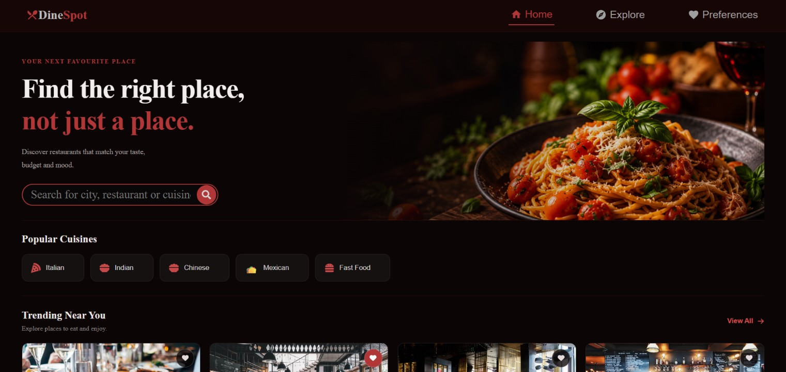

#  DineSpot — Discover Your Next Favorite Restaurant

DineSpot is a restaurant discovery web application that helps users explore restaurants, search for cuisines and dishes, save favorites, compare restaurants, and discover places that match their food preferences.

##  Features

- **Restaurant Discovery:** Explore restaurants using live place data from Geoapify.
- **Smart Search:** Search for restaurant names, cuisines, and dishes.
- **City-Based Search:** Discover restaurants in supported cities.
- **Cuisine Filters:** Browse options such as Indian, Italian, Chinese, Mexican, and fast food.
- **Favorites:** Save your favorite restaurants.
- **Restaurant Comparison:** Compare up to three restaurants.
- **Personalized Preferences:** Get match scores based on food preferences.
- **Restaurant Details:** View available restaurant information.
- **Responsive Interface:** Explore restaurants through a dedicated frontend interface.

##  Technologies Used

**Frontend**
- React.js
- JavaScript
- HTML5
- CSS3

**Backend**
- Node.js
- Express.js
- Geoapify Places API
- Geoapify Geocoding API

##  Project Structure

```text
DineSpot/
├── server/
│   ├── server.js
│   └── .env
├── src/
│   ├── components/
│   ├── pages/
│   ├── features/
│   ├── services/
│   ├── hooks/
│   └── App.js
├── public/
├── package.json
└── README.md
```

##  Getting Started

### 1. Clone the repository

```bash
git clone https://github.com/YOUR-USERNAME/DineSpot.git
cd DineSpot
```

Replace `YOUR-USERNAME` with your GitHub username.

### 2. Install frontend dependencies

```bash
npm install
```

### 3. Configure the backend

Open a terminal in the project root and run:

```bash
cd server
npm install
```

Create a `.env` file inside the `server` folder and add your Geoapify API key:

```env
GEOAPIFY_API_KEY=your_geoapify_api_key
```

Get an API key from [Geoapify](https://www.geoapify.com/).

**Security:** Never upload your `.env` file or expose your API key in your public repository.

### 4. Start the backend

From the `server` folder, run:

```bash
node server.js
```

The backend should start at:

```text
http://localhost:5000
```
### Preview


### 5. Start the frontend

Open a **second terminal** in the project root and run:

```bash
npm start
```

The React application will usually open at:

```text
http://localhost:3000
```

Keep both terminals running while using the application locally.

##  API Endpoint

The backend provides a restaurant search endpoint:

```text
GET /api/restaurants
```

Supported query parameters include:

| Parameter | Description |
|---|---|
| `near` | Location used for restaurant discovery |
| `query` | Restaurant name, cuisine, or dish |
| `limit` | Maximum number of results |

Example:

```text
http://localhost:5000/api/restaurants?near=Chennai&query=restaurant&limit=10
```

##  Notes and Limitations

- Available restaurant information depends on Geoapify's data.
- Ratings and prices may be unavailable for some or all results.
- Fallback images may not represent the actual restaurant.
- City-only search currently supports a predefined list of cities.
- Search results depend on API availability and the quality of location data.

##  Future Improvements

- Support automatic discovery for more cities.
- Display verified restaurant photos.
- Integrate reliable restaurant ratings and price information.
- Add restaurant reviews and user accounts.
- Deploy the frontend and backend for public access.

##  Project Goal

The goal of DineSpot is to make restaurant discovery easier and more enjoyable through search, personalized preferences, favorites, and restaurant comparison.

##  Author

**Kondeti Rakshitha**

Built with ❤️ using React, JavaScript, Node.js, Express, and Geoapify.
